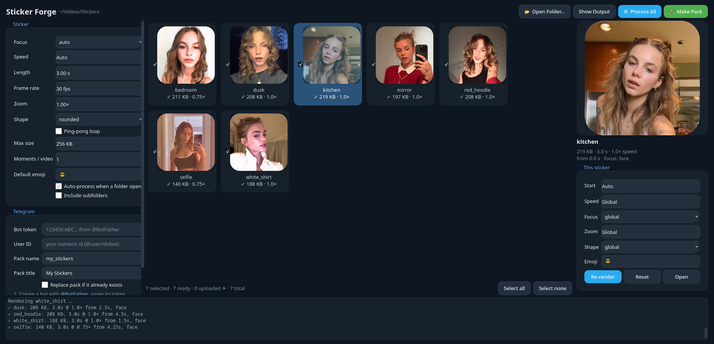
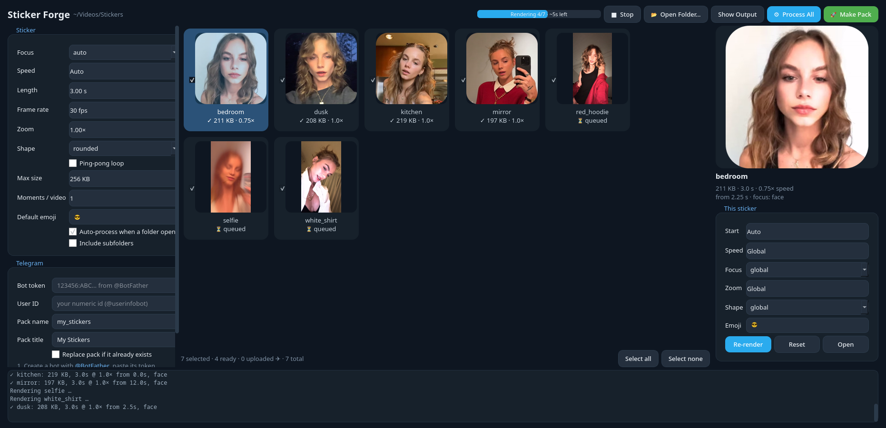

# Telegram Sticker Maker

**Sticker Forge**: a desktop app that turns a folder of videos into Telegram video sticker packs, mostly automatically.




Works on **Windows** and **Linux**. It needs two things installed, [uv](https://docs.astral.sh/uv/) and ffmpeg. uv fetches Python and the app's libraries (PySide6, OpenCV, numpy, requests) on first launch, which is about 150 MB once.

## Windows

1. Open **PowerShell** and install uv, ffmpeg and Git:
   ```powershell
   winget install astral-sh.uv
   winget install Gyan.FFmpeg
   winget install Git.Git
   ```
   Close and reopen PowerShell afterwards so the new commands are found.
2. Download the app:
   ```powershell
   git clone https://github.com/annashumate1/Telegram-Sticker-Maker
   ```
   You can skip Git: on the GitHub page, click **Code > Download ZIP** and extract it.
3. Start it by double-clicking **`run_windows.bat`** in the folder, or run:
   ```powershell
   cd Telegram-Sticker-Maker
   uv run stickermaker.py
   ```

## Linux

1. Install uv and ffmpeg:
   ```sh
   sudo pacman -S uv ffmpeg                                  # Arch and derivatives
   sudo apt install ffmpeg && curl -LsSf https://astral.sh/uv/install.sh | sh   # Ubuntu / Debian
   ```
2. Download and start:
   ```sh
   git clone https://github.com/annashumate1/Telegram-Sticker-Maker && cd Telegram-Sticker-Maker
   uv run stickermaker.py
   ```

## Command line (both systems)

```sh
uv run stickermaker.py "path/to/videos"   # GUI, open a folder straight away
uv run sticker_engine.py "path/to/videos" # no GUI: render every video into <folder>/stickers
uv run sticker_engine.py --selftest       # quick check that ffmpeg and the pipeline work
```
`python stickermaker.py` also works; it relaunches itself through uv. If ffmpeg is missing, the app says so on startup and tells you how to install it.

**What it does by default**
- Scans the whole video and picks the best 3 s: lively, faces on screen, no scene cuts.
- Tracks the face (YuNet) or body (HOG), holds the same subject and pans smoothly. With no subject it center-crops.
- Auto speed: speeds up static clips (max 2x) and slows down frantic ones (0.75x).
- Encodes VP9 WEBM at 512x512, max 3 s, max 30 fps, no audio, and drops the bitrate until the file fits the size cap.
- Optional extras: rounded or circle shape (transparent corners), ping-pong loop, several moments per long video.
- Per-sticker overrides: start, speed, focus, zoom, shape and emoji. Work is saved in `stickers/.stickerforge.json`, so reopening a folder doesn't re-render.



**Convenience:** the app reopens your last folder on launch, and there's an option to include subfolders. You get a Stop button, an ETA for rendering and uploading, and Select all / none. Double-click a card to play it; right-click for re-render, open sticker or source, or show the folder. Cards marked as uploaded are already in your pack.

**Telegram pack:** create a bot with @BotFather, get your numeric ID from @userinfobot, send `/start` to your bot, fill in the Telegram box, then click **Make Pack**.
Telegram's Bot API rejects video stickers over 256 KB. If you raise *Max size* (up to 15 MB), send the files from `stickers/` to @fStikBot instead; it re-compresses them.

**Where things are saved:**
- Rendered stickers go into a `stickers` folder inside your video folder.
- Settings, including the bot token, are stored as plain text. On Linux they're in `~/.config/stickerforge/stickerforge.conf`; on Windows, in the registry under `HKEY_CURRENT_USER\Software\stickerforge`.
- The face-detection model (230 KB) is downloaded once into `~/.cache/stickerforge` (Windows: `%USERPROFILE%\.cache\stickerforge`).

## License

Distributed under the GNU General Public License, version 3. See [LICENSE](LICENSE).

## Terms and Conditions

By downloading and using this program you agree that Anna is beautiful and deserves every ounce of respect you have.


